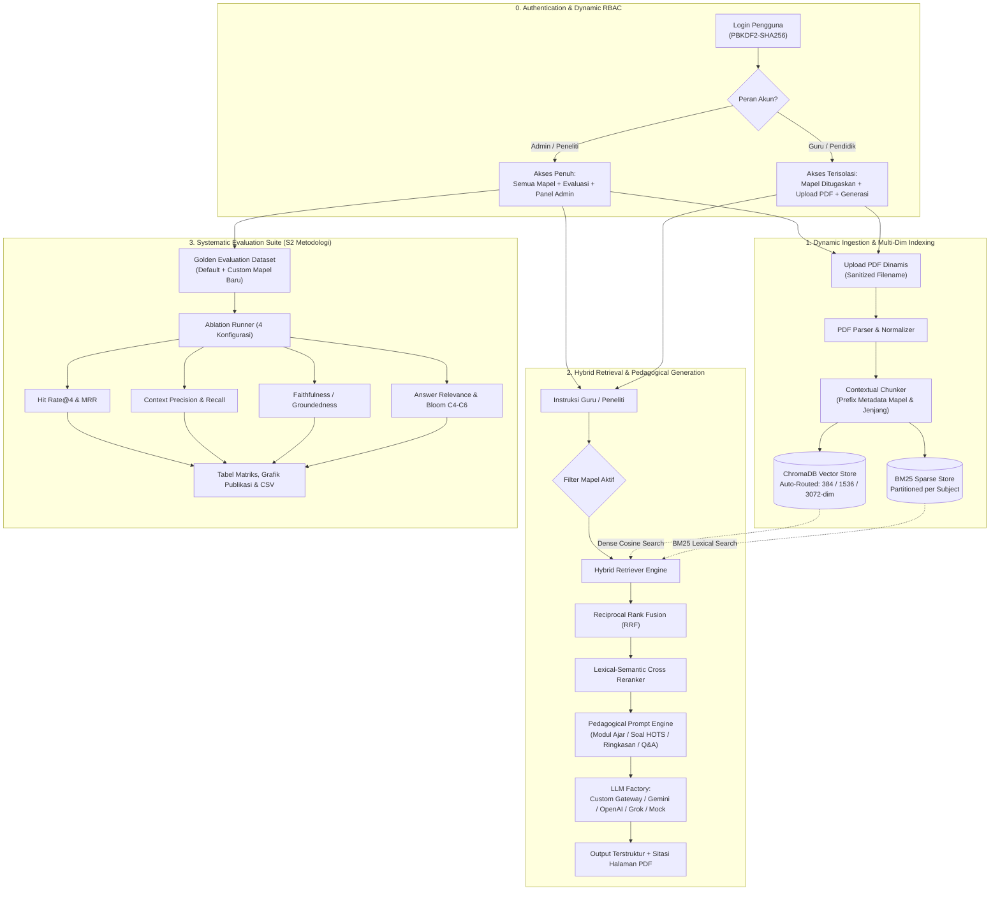

# Dynamic Multi-Subject Pedagogical RAG Pipeline with Systematic Evaluation Framework
### Implementasi Riset Pascasarjana (S2) — Bahan Ajar & Asesmen Kurikulum Merdeka Berbasis Multi-Mapel Dinamis & RBAC

[](https://colab.research.google.com/github/idhiatmojo/justrag/blob/main/notebooks/JustRAG_Colab_EndToEnd.ipynb)

Proyek ini mengimplementasikan arsitektur **Retrieval-Augmented Generation (RAG) End-to-End** tingkat pascasarjana untuk pembuatan bahan ajar, modul pembelajaran (**Kurikulum Merdeka**), ringkasan materi, dan paket soal **HOTS** (*Higher Order Thinking Skills* berdasar Taksonomi Bloom C4–C6) di atas dokumen buku ajar PDF yang dikelola secara dinamis.

Versi terbaru sistem ini mencakup **5 pilar arsitektur utama**:
1. **Isolasi Domain & Pencegahan Kontaminasi Silang (*Cross-Domain Contamination*)**: Memisahkan konteks materi antar mata pelajaran menggunakan *metadata routing & pre-filtering* pada Vector DB dan partisi indeks BM25 per mapel.
2. **Manajemen Multi-Mapel & Multi-Guru Dinamis berbasis Peran (*RBAC*)**: Mendukung penambahan/pengeditan mata pelajaran lintas jenjang/fase (Kelas X/XI/XII, Fase E/F) serta pengelolaan akun Guru dan penugasan mapel secara langsung dari Web UI tanpa mengubah kode.
3. **Auto-Routing Koleksi Vektor Multi-Dimensi & Ingesti Inkremental**: Menambahkan PDF baru tanpa *re-indexing* seluruh korpus, serta otomatis memisahkan koleksi ChromaDB berdasarkan dimensi embedding (`384-dim` FastEmbed Lokal, `1536-dim` OpenAI, `3072-dim` Gemini) agar bebas bentrok dimensi vektor.
4. **Multi-Provider LLM & Offline Neural Embedding**: Mendukung Custom OpenAI-Compatible Gateway (TamanData, JuanRouter, Ollama, DeepSeek), Google Gemini, OpenAI, xAI Grok, serta **FastEmbed Neural ONNX (`all-MiniLM-L6-v2`)** yang berjalan 100% lokal di CPU tanpa API key.
5. **Metodologi Evaluasi Saintifik & Studi Komparatif (*Ablation Study*)**: Menguji 4 varian konfigurasi pipeline pada *Golden Evaluation Dataset* (yang juga dapat diperluas untuk mapel baru via UI) dengan ekspor laporan CSV dan grafik publikasi.

---

## 🏛️ Arsitektur Sistem (Versi Terkini)



---

## 📂 Struktur Direktori Proyek

```text
justrag/
├── app.py                          # Aplikasi Web Utama Streamlit (Multi-Tab berbasis RBAC)
├── Dockerfile                      # Konfigurasi image container Python 3.11 + Healthcheck
├── docker-compose.yml              # Orkestrasi deployment server (port 8501 & persistent volume)
├── requirements.txt                # Daftar dependensi Python
├── .env.example                    # Template variabel environment
├── notebooks/
│   └── JustRAG_Colab_EndToEnd.ipynb # Notebook interaktif Google Colab (Pipeline + Evaluasi + Tunnel UI)
├── scripts/
│   ├── generate_sample_data.py     # Generator PDF buku ajar contoh awal (Fase E Kelas X)
│   └── run_evaluation.py           # CLI runner untuk benchmark Ablation Study S2
├── src/
│   ├── config.py                   # Konfigurasi global & sinkronisasi awal mapel/direktori
│   ├── auth.py                     # UI Login, sesi autentikasi live-sync, & ubah sandi mandiri
│   ├── user_manager.py             # CRUD akun Guru/Admin, PBKDF2-SHA256 hashing, & filter akses mapel
│   ├── subject_manager.py          # CRUD mata pelajaran dinamis & manajemen folder korpus
│   ├── admin_panel.py              # UI Tab Pusat Manajemen Mapel & Guru (khusus Admin)
│   ├── llm_factory.py              # Factory LLM & Embedding (Gemini, OpenAI, Grok, Custom, FastEmbed, Mock)
│   ├── custom_providers.py         # Manajemen preset endpoint OpenAI-compatible (/v1/models & ping test)
│   ├── ingestion/
│   │   ├── pdf_parser.py           # Ekstraksi teks & metadata halaman PDF
│   │   ├── chunker.py              # Contextual sentence chunker dengan injeksi header metadata
│   │   └── pipeline.py             # Pipeline ingesti inkremental ke ChromaDB + BM25
│   ├── storage/
│   │   ├── vector_store.py         # ChromaDB persistent store dengan auto-routing dimensi vektor
│   │   └── bm25_store.py           # Indeks leksikal BM25Okapi terpartisi per mata pelajaran
│   ├── retrieval/
│   │   ├── hybrid_retriever.py     # Pencarian Dense + Sparse BM25 dengan Reciprocal Rank Fusion (RRF)
│   │   └── reranker.py             # Lexical-Semantic Cross-Scoring Reranker
│   ├── generation/
│   │   ├── prompts.py              # Template prompt pedagogis Kurikulum Merdeka & aturan sitasi ketat
│   │   └── generator.py            # Orkestrator generasi bahan ajar & ekstraksi sitasi sumber
│   └── evaluation/
│       ├── synthetic_data.py       # Manajer Golden Evaluation Dataset (mendukung tambah soal uji baru)
│       ├── metrics.py              # Kalkulasi kuantitatif Retrieval, Faithfulness, & Bloom Compliance
│       └── evaluator.py            # Mesin eksperimen komparatif 4 varian Ablation Study
└── data/                           # Penyimpanan persisten (dimount sebagai volume pada Docker)
    ├── raw_pdf/<kode_mapel>/       # Dokumen PDF fisik per mata pelajaran
    ├── chroma_db/                  # Database vektor ChromaDB
    ├── bm25_db/                    # Cache indeks leksikal BM25 (.pkl per mapel)
    ├── models_cache/               # Cache model ONNX FastEmbed lokal
    ├── evaluation/                 # golden_testset.json & hasil CSV benchmark
    ├── subjects.json               # Konfigurasi mata pelajaran dinamis (dibuat otomatis)
    ├── users.json                  # Database akun & hash sandi pengguna (dibuat otomatis)
    └── custom_providers.json       # Preset endpoint LLM custom tersimpan (dibuat otomatis)
```

---

## 📚 Cakupan Mata Pelajaran Bawaan & Ekspansi Dinamis

Saat pertama kali dijalankan, sistem memuat **3 mata pelajaran bawaan Fase E (Kelas X)** di `data/subjects.json`, dan **Admin dapat menambah/mengedit/menghapus mapel apa pun** (mis. *Matematika*, *Fisika*, *Sejarah*, Kelas XI/XII) langsung dari dashboard UI:

1. **Bahasa Inggris (`bahasa_inggris`)**:
   - Genre teks: Narrative, Descriptive, Recount, Report Text, Announcement.
   - Tata Bahasa: Simple Past vs Present Perfect Tense & HOTS Reading Comprehension.
2. **Informatika (`informatika`)**:
   - 4 Pilar Berpikir Komputasional (Dekomposisi, Pengenalan Pola, Abstraksi, Algoritma).
   - Jaringan Komputer & Internet (Topologi Star vs Bus, Model TCP/IP, Enkripsi HTTPS/TLS).
   - Algoritma Pemrograman (Flowchart, Pseudocode, Percabangan & Perulangan).
3. **KKA - Koding & Kecerdasan Artifisial (`kka`)**:
   - Logika Pemrograman AI dengan Python (List, Tuple, Dictionary, kontrol alur).
   - Paradigma Machine Learning: Supervised vs Unsupervised Learning.
   - Etika AI (Mitigasi bias algoritma, *fairness metrics*, *human-in-the-loop*) & *Prompt Engineering* (*Few-Shot*, *Chain-of-Thought*).

---

## 🤖 Dukungan Model LLM & Arsitektur Multi-Dimensi Embedding

Sistem menggunakan pola modular di `src/llm_factory.py` dan `src/custom_providers.py` dengan mekanisme *auto-retry* untuk *rate-limit* (`429`) maupun *gateway timeout* (`502/503/504`):

- **Custom OpenAI-Compatible Gateway**:
  - Mendukung endpoint pihak ketiga maupun server lokal (preset bawaan: **TamanData**, **JuanRouter**, serta kompatibel dengan DeepSeek, Ollama `http://localhost:11434/v1`, vLLM).
  - Dilengkapi tombol **🔄 Tarik Model** (otomatis membaca `/v1/models`), **🔌 Tes Koneksi**, dan penyimpanan preset permanen di `data/custom_providers.json` tanpa perlu mengubah `.env`.
- **Google Gemini**:
  - Model Generasi: `gemini-3.5-flash` (Default), `gemini-3.8-flash`, `gemini-3.7-flash`, `gemini-flash-latest` (atau `gemini-2.5-flash` via Colab/CLI).
  - Embedding Cloud: `gemini-embedding-001` (**3072-dim**, otomatis diarahkan ke koleksi `curriculum_rag_docs`).
- **OpenAI**:
  - Model Generasi: `gpt-4o-mini`, `gpt-4o`.
  - Embedding Cloud: `text-embedding-3-small` (**1536-dim**, otomatis diarahkan ke koleksi `curriculum_rag_docs_openai_1536`).
- **xAI Grok**:
  - Model Generasi: `grok-3-mini`, `grok-3`, `grok-2` (dengan delegasi embedding ke `local`, `gemini`, atau `openai`).
- **FastEmbed Neural Local Embedding (`local`) & Mode Simulasi (`mock`)**:
  - Menggunakan `sentence-transformers/all-MiniLM-L6-v2` berbasis **ONNX Runtime** (**384-dim**, otomatis diarahkan ke koleksi `curriculum_rag_docs_local_384`). Berjalan 100% offline di CPU tanpa membutuhkan API key.

---

## 🔐 Autentikasi & Pembagian Hak Akses (RBAC)

Sistem autentikasi (`src/auth.py` & `src/user_manager.py`) mengenkripsi seluruh kata sandi menggunakan **PBKDF2-HMAC-SHA256** (200.000 iterasi + *constant-time comparison*) di `data/users.json` serta menyinkronkan hak akses sesi secara *real-time*:

| Peran Pengguna | Akun Demo Bawaan | Hak Akses Fitur & Isolasi Data |
| :--- | :--- | :--- |
| **🛡️ Admin / Peneliti** | Username: `admin`<br/>Sandi: `admin123` | • Mengakses seluruh mata pelajaran yang terdaftar<br/>• Mengatur API Key serta menambah/menyimpan/menghapus Preset LLM Custom<br/>• Tab **Metodologi Evaluasi & Ablation Study** (+ tambah soal *Golden Testset*)<br/>• Tab **Manajemen Dokumen & Analisis Korpus Global** (lintas koleksi ChromaDB & BM25)<br/>• Tab **Manajemen Mapel & Guru** (CRUD Mapel, CRUD Guru/Admin, penugasan mapel, reset sandi) |
| **👨‍🏫 Guru / Pendidik** | Username: `guru`<br/>Sandi: `guru123` | • Dropdown mapel & statistik korpus otomatis dibatasi hanya pada mapel yang ditugaskan Admin (*mapel tertentu* atau *semua mapel*)<br/>• Mengunggah PDF baru, mengindeks ulang, dan menghapus file PDF pada mapel yang diampunya<br/>• Menggunakan seluruh mode generasi (**Modul Ajar**, **Soal HOTS**, **Ringkasan**, **Q&A**) dengan **Isolasi Filter Mapel terkunci aktif**<br/>• Mengubah kata sandi pribadi di sidebar (API Key global, Tab Evaluasi, & Panel Admin disembunyikan) |

> *Catatan:* Autentikasi dapat dinonaktifkan untuk kebutuhan pengembangan lokal dengan mengatur `AUTH_ENABLED=false` pada file `.env`.

---

## 🔬 Metodologi Evaluasi Sistematis (Ablation Study)

Evaluasi memisahkan pengukuran kinerja **Retrieval** dan **Generation** melalui 4 skenario eksperimen:

| Konfigurasi | Deskripsi | Tujuan Eksperimen |
| :--- | :--- | :--- |
| **1. Baseline (Naive Dense, No Filter)** | Dense Vector Only, Tanpa Filter Mapel | Membuktikan terjadinya *domain cross-contamination* |
| **2. Naive + Mapel Filter** | Dense Vector Only + Metadata Filter Mapel | Mengukur dampak isolasi metadata domain |
| **3. Hybrid (Dense+BM25) + Filter** | Hybrid (Dense + BM25 RRF) + Filter Mapel | Mengukur kontribusi pencarian leksikal untuk istilah teknis |
| **4. Proposed (Hybrid+Filter+Reranker)** | Hybrid + Filter + Cross-Reranker + Grounded Prompting | Mengukur performa end-to-end arsitektur yang diusulkan |

### Metrik Kuantitatif Terukur:
- **Retrieval**: `Hit Rate@4`, `MRR (Mean Reciprocal Rank)`, `Context Precision`, `Context Recall`.
- **Generation**: `Faithfulness (Groundedness / Anti-Halusinasi)`, `Answer Relevance`, `Bloom's Taxonomy Compliance (C1–C6)`.
- **Efisiensi**: `Latency (detik)`.

---

## 🚀 Langkah-Langkah Instalasi & Menjalankan Aplikasi

### Opsi A: Menjalankan dengan Docker Compose (Direkomendasikan untuk Server)
```bash
# 1. Salin konfigurasi environment (opsional, sesuaikan API Key atau kredensial awal)
cp .env.example .env

# 2. Bangun dan jalankan container di background
docker compose up -d --build

# 3. Akses aplikasi melalui browser
# http://localhost:8501
```

### Opsi B: Menjalankan secara Lokal dengan Python (3.10+)
```bash
# 1. Buat & aktifkan virtual environment, lalu pasang seluruh dependensi
python3 -m venv .venv
source .venv/bin/activate
pip install -r requirements.txt

# 2. Salin konfigurasi environment
cp .env.example .env

# 3. (Opsional) Buat PDF dokumen contoh awal kurikulum Fase E Kelas X
python scripts/generate_sample_data.py

# 4. Jalankan Web UI Streamlit
streamlit run app.py
```
Buka browser di `http://localhost:8501`.

---

## 🛠️ Langkah-Langkah Penggunaan Manajemen Mapel & Guru (Web UI)

### Langkah 1: Masuk sebagai Administrator
1. Buka `http://localhost:8501` di browser.
2. Login menggunakan akun **Admin** (default: `admin` / `admin123`, atau sesuai `APP_ADMIN_USER` & `APP_ADMIN_PASSWORD` pada `.env`).
3. Klik tab ke-4 di bagian atas halaman utama: **`🛠️ Manajemen Mapel & Guru`**.

### Langkah 2: Menambah, Mengedit, atau Menghapus Mata Pelajaran (Mapel)
1. Buka sub-tab **`📚 Kelola Mata Pelajaran (Mapel)`**.
2. Pada panel kiri (**`➕ Tambah Mata Pelajaran Baru`**), isi form berikut:
   - **Nama Mata Pelajaran \***: Contoh `Matematika (Kelas X)` atau `Fisika (Kelas XI)`.
   - **Jenjang / Fase**: Contoh `Kelas X`, `Kelas XI`, `Fase E`, atau `Fase F`.
   - **Kode Unik Mapel (Opsional)**: Contoh `matematika` *(kosongkan bila ingin dibuat otomatis)*.
   - **Deskripsi Materi / Elemen CP**: Ringkasan cakupan materi kurikulum.
   - **Contoh Prompt Default (Opsional)**: Topik contoh yang akan muncul otomatis di kotak instruksi Tab Generatif.
3. Klik **`➕ Tambahkan Mata Pelajaran`**. Sistem langsung membuat folder `data/raw_pdf/<kode_mapel>` dan mengaktifkan mapel tersebut tanpa perlu me-restart server.
4. Gunakan panel kanan (**`✏️ Edit / Hapus Mata Pelajaran`**) bila ingin memperbarui deskripsi/prompt atau menghapus mapel (tersedia opsi untuk ikut membersihkan file PDF fisik serta indeks ChromaDB & BM25).

### Langkah 3: Menambah Akun Guru & Menugaskan Mapel
1. Pindah ke sub-tab **`👨‍🏫 Kelola Akun Guru & Pengguna`**.
2. Pada panel kiri (**`➕ Tambah Akun Guru / Pengguna Baru`**):
   - Pilih **Tipe Akun**: **`👨‍🏫 Guru / Pendidik`** (atau **`🛡️ Admin / Peneliti`**).
   - Pilih **Hak Akses Mata Pelajaran**:
     - **`🎯 Pilih Mapel Tertentu`**: Membatasi guru hanya pada 1 atau beberapa mata pelajaran yang dipilih.
     - **`🌐 Semua Mata Pelajaran`**: Memberi guru akses ke seluruh mata pelajaran aktif.
   - Isi **Username Login \*** (contoh: `guru_mtk`), **Nama Lengkap & Gelar \*** (contoh: `Budi Santoso, S.Pd.`), dan **Kata Sandi Awal \*** (minimal 4 karakter).
   - Pilih daftar mapel yang diampu (bila memilih *Pilih Mapel Tertentu*), sesuaikan **Label Jabatan** & **Badge**, lalu klik **`➕ Buat Akun Pengguna`**.
3. Gunakan panel kanan (**`✏️ Edit Akun, Penugasan Mapel & Reset Sandi`**) untuk mengubah penugasan mapel, menonaktifkan/mengaktifkan izin login akun, mereset kata sandi, atau menghapus akun pengguna.

### Langkah 4: Upload Materi PDF & Generasi Konten oleh Guru
1. Login menggunakan akun Guru yang telah dibuat.
2. **Pilih Mapel**: Pada sidebar kiri bagian **`1. Pilih Mata Pelajaran`**, pilih mata pelajaran yang diampu.
3. **Upload & Indeks PDF Materi**:
   - Pada sidebar kiri bagian **`3. Dynamic Ingestion PDF`**, pilih satu atau beberapa file PDF modul/buku ajar.
   - Klik **`📥 Proses & Indeks PDF ke Vector DB`** hingga status indeks selesai (`✅ Selesai`).
   - Buka tab **`📂 Dokumen Materi Mapel`** apabila ingin melihat daftar PDF, melakukan indeks ulang, atau menghapus file PDF tertentu beserta *chunk*-nya dari database.
4. **Hasilkan Bahan Ajar / Soal HOTS**:
   - Buka tab **`🚀 Generatif Bahan Ajar & Asesmen`**.
   - Pilih **Mode Generasi Pedagogis** (*Modul Ajar*, *Generator Paket Soal HOTS Bloom C4–C6*, *Ringkasan Konsep*, atau *Tanya Jawab Terpandu*) serta **Strategi Retrieval**.
   - Tulis instruksi/topik pembelajaran lalu klik **`✨ Hasilkan Konten dengan RAG`**.
   - Hasil generasi akan ditampilkan lengkap dengan panel **Bukti Grounding & Konteks Dokumen Terambil** (nama file PDF, nomor halaman, dan skor relevansi).
5. **Ubah Kata Sandi Mandiri**: Buka menu **`🔑 Ubah Kata Sandi`** pada kartu profil pengguna di sidebar kiri atas kapan saja untuk memperbarui kata sandi sendiri.

---

## 📊 Langkah-Langkah Menjalankan Evaluasi & Ablation Study

### 1. Melalui Web UI Streamlit (Khusus Admin)
1. Login sebagai **Admin**, lalu buka tab ke-2: **`📊 Metodologi Evaluasi & Ablation Study`**.
2. *(Opsional — Menambah Soal Uji untuk Mapel Baru)* Buka panel **`📝 Kelola Golden Testset Evaluasi`**, pilih mata pelajaran, lalu tambahkan pertanyaan uji beserta level Bloom (`C4`/`C5`/`C6`), jawaban referensi (*ground truth*), dan kata kunci ekspektasi.
3. Pilih **Cakupan Evaluasi** (*Semua Mapel Cross-Domain* atau satu mapel spesifik), kemudian klik **`⚡ Jalankan Eksperimen Evaluasi Lengkap`**.
4. Analisis tabel matriks performa dan grafik perbandingan metrik yang muncul, lalu klik **`💾 Unduh Hasil Evaluasi (CSV untuk Laporan Tesis)`** untuk mengunduh hasil dalam format CSV.

### 2. Melalui Command Line Interface (CLI)
```bash
# Menjalankan evaluasi lengkap lintas seluruh mapel
python scripts/run_evaluation.py --provider gemini --model gemini-3.5-flash

# Menjalankan evaluasi khusus satu mapel (misal: informatika)
python scripts/run_evaluation.py --subject informatika --provider gemini

# Menjalankan pengujian pipeline secara offline (Mock LLM + FastEmbed Neural Local)
python scripts/run_evaluation.py --provider mock
```
Hasil evaluasi otomatis disimpan ke `data/evaluation/ablation_benchmark_results.csv`.

---

## ☁️ Langkah-Langkah Menjalankan di Google Colab

Tersedia notebook interaktif lengkap di `notebooks/JustRAG_Colab_EndToEnd.ipynb` untuk menjalankan eksperimen kode Python, visualisasi grafik tesis, hingga membuka Web UI Streamlit langsung dari **Google Colab**.

### Cara Membuka Notebook di Google Colab
- **Cara 1 (1-Klik Langsung dari GitHub):**  
  Klik badge **Open in Colab** di bagian paling atas README ini, atau akses:  
  👉 `https://colab.research.google.com/github/idhiatmojo/justrag/blob/main/notebooks/JustRAG_Colab_EndToEnd.ipynb`
- **Cara 2 (Upload File `.ipynb` Manual):**  
  Buka [colab.research.google.com](https://colab.research.google.com) ➔ tab **Upload** ➔ unggah file `notebooks/JustRAG_Colab_EndToEnd.ipynb`.

### Urutan Langkah Eksekusi di Dalam Google Colab
> 💡 **Eksekusi Cepat:** Klik menu **`Runtime` ➔ `Run all`** untuk menjalankan Tahap 1 s/d Tahap 7 secara otomatis dari awal hingga menghasilkan grafik *Ablation Study*.

1. **Tahap 1 — Setup Repository & (Opsional) Mount Google Drive**:
   - Jalankan **Sel 1A** untuk otomatis mengkloning repositori `justrag` dan menginstal seluruh dependensi Python.
   - *(Opsional)* Pada **Sel 1B**, centang `MOUNT_GOOGLE_DRIVE = True` agar folder `data/` (ChromaDB, BM25, PDF, serta daftar mapel/guru) tersimpan permanen di Google Drive Anda antar-sesi Colab.
2. **Tahap 2 — Konfigurasi Provider LLM & Embedding**:
   - Simpan API Key di panel **🔑 Secrets** Google Colab (mis. `GEMINI_API_KEY`, `OPENAI_API_KEY`, `XAI_API_KEY`, atau `CUSTOM_API_KEY`) dan nyalakan akses notebook, **atau** isi pada kolom `API_KEY_MANUAL`.
   - Pilih `EMBEDDING_PROVIDER = "local"` untuk menggunakan **FastEmbed Neural (`all-MiniLM-L6-v2` 384-dim)** yang bebas kuota API, atau `"gemini"` / `"openai"` untuk embedding cloud.
   - *(Tanpa API Key? Pilih `LLM_PROVIDER = "mock"` agar seluruh alur pengujian tetap berjalan 100% offline).*
3. **Tahap 3 — Manajemen Mata Pelajaran Dinamis**:
   - Menampilkan tabel mata pelajaran aktif. Centang `TAMBAH_MAPEL_BARU = True` pada **Sel 3** bila ingin mendaftarkan mata pelajaran baru langsung dari notebook.
4. **Tahap 4 — Indeks Dokumen Contoh & Upload PDF Sendiri**:
   - Jalankan **Sel 4A** untuk membuat dan mengindeks PDF contoh awal ke ChromaDB dan BM25.
   - Untuk mengunggah PDF buku ajar dari komputer Anda, pada **Sel 4B** isi `TARGET_KODE_MAPEL`, centang `UPLOAD_PDF_SEKARANG = True`, jalankan sel, dan pilih file `.pdf` pada dialog upload yang muncul.
5. **Tahap 5 — Uji Hybrid Retrieval & Reranking**:
   - Uji kueri pencarian dengan kombinasi parameter `MODE_RETRIEVAL`, `ISOLASI_FILTER_MAPEL`, dan `AKTIFKAN_RERANKER` untuk melihat tabel perbandingan skor RRF dan *rerank score*.
6. **Tahap 6 — Generasi Modul Ajar & Paket Soal HOTS**:
   - Pilih mapel, mode pedagogis (`modul_ajar`, `soal_hots`, `ringkasan`, `qa_chat`), dan topik instruksi untuk menghasilkan materi terformat Markdown lengkap dengan tabel sitasi halaman PDF.
7. **Tahap 7 — Benchmark Ablation Study S2 & Unduh Grafik/CSV**:
   - Jalankan **Sel 7A** untuk mengeksekusi 4 varian pipeline dan merender grafik publikasi resolusi tinggi (`ablation_benchmark_chart.png`) serta tabel `ablation_benchmark_results.csv`.
   - Centang `UNDUH_HASIL_EVALUASI = True` pada **Sel 7B** untuk mengunduh file CSV dan PNG langsung ke perangkat Anda.
8. **Tahap 8 — (Opsional) Jalankan Full Web UI Streamlit via Cloudflare Quick Tunnel**:
   - Centang `JALANKAN_STREAMLIT_UI = True` pada **Sel 8** lalu jalankan selnya.
   - Klik URL publik **`https://....trycloudflare.com`** yang muncul pada output untuk membuka aplikasi web Streamlit lengkap (halaman Login, Upload PDF, Evaluasi, serta Panel Admin Manajemen Mapel & Guru) tanpa perlu mendaftar akun tunnel apa pun.
